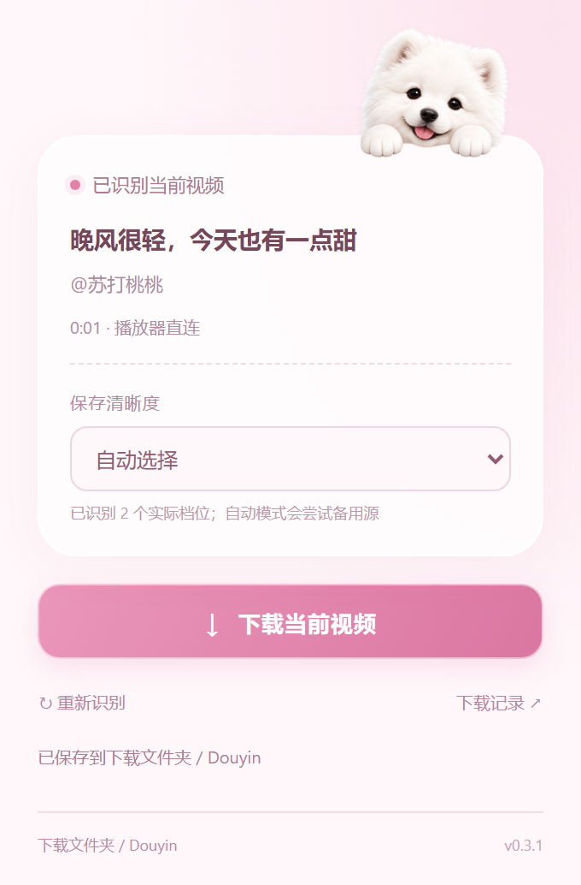

# 抖音视频下载 · Edge 扩展

一个简洁的抖音网页版视频下载扩展：自动浮现下载卡片、按实际分辨率选画质，搭配粉色界面和一只趴在卡片上的萨摩耶幼犬。

A lightweight Microsoft Edge extension for downloading Douyin web videos, with an automatic floating card, resolution selection, and a pink Samoyed interface. Manifest V3, no build step, no runtime dependencies.


> 预览使用虚构标题和本地生成的测试素材，不包含真实账号页面或下载记录。

## 功能

- 唯一可见视频正在播放时，自动显示页面下载卡片；支持收起为小狗图标。
- 读取当前作品提供的实际清晰度。同一分辨率的不同码率、编码和备用地址合并成一个选项。
- 手选分辨率后，只尝试该分辨率的可用源；自动模式可尝试同作品其他可用源。
- 下载前重新核对作品及播放器，避免切换视频后误下载预加载内容。
- 失败时进行有限的同档地址重试；必要时加载独立作品页重新取源，结束后自动关闭辅助页。
- 流式写入浏览器磁盘暂存文件，无人为设置的 256 MB 文件上限；显示下载进度。
- 无第三方解析服务、统计、遥测或额外本地服务。

## 安装

需要 Microsoft Edge 111 或更新版本。

1. 在仓库的 **Releases** 下载 `douyin-edge-v0.3.1.zip`，解压；也可下载源码 ZIP。
2. 打开 `edge://extensions/`，开启「开发人员模式」。
3. 点击「加载解压缩的扩展」，选择包含 `manifest.json` 的 `extension` 文件夹。
4. 允许扩展访问抖音网站，**刷新已经打开的抖音页面**，播放视频。

升级时覆盖扩展目录，在扩展管理页点「重新加载」，再刷新抖音页面。

## 使用

打开抖音网页版并播放一个视频，右下角会出现下载卡片。选择「自动选择」或一个分辨率，再点「下载」。暂停时也可使用浏览器工具栏中的扩展弹窗。



文件保存到 Edge 默认下载目录下的 `Douyin` 文件夹。文件名包含标题、作品 ID，手选画质还会附加分辨率；同名文件自动编号。

读取期间请保留原播放标签页及扩展自动打开的辅助页，不要刷新或关闭它们。辅助取源可能短暂切换到独立作品页，开始读取后返回原页，完成或失败后关闭辅助页。关闭工具栏弹窗不会停止已开始的任务。

## 常见问题

**为什么没有 1080p，或者只有一个画质？**

扩展只展示当前作品实际暴露的完整视频地址，不生成虚假画质。可先在网页播放器切换画质并播放片刻，再重新识别。短边像素用作画质标签，例如 `1080 × 1920` 标为 `1080p`。无法确认分辨率的版本合并为「其他可用画质」。

**为什么仍可能出现 403？**

媒体地址可能过期，或受到服务器、登录状态、跨域规则及网络环境限制。扩展会有限重试并重新取源；所有可用地址仍被拒绝时会停止并显示错误。它不会绕过登录、页面验证或媒体保护。429 限流立即停止。

**大文件下载需要多少空间？**

大小受浏览器存储配额与可用磁盘限制。暂存文件和最终下载会短暂各占一份空间。连续两分钟没有数据才报读取超时，不按视频总大小或总传输时长中断。

**支持哪些内容？**

支持能与当前作品匹配的完整 MP4。暂不支持直播、图集、DRM、HLS/DASH 清单、独立音视频轨道的合并，以及无法匹配完整地址的 Blob 播放源。原生视频全屏和画中画不保证显示页面卡片，可退出全屏后操作。

## 权限与隐私

| 权限 | 用途 |
| --- | --- |
| `activeTab`、`scripting` | 识别当前视频，并在播放页面执行读取任务 |
| `downloads` | 将已读取的视频交给 Edge 保存及查询保存结果 |
| `storage` | 本机会话内保存下载进度及任务状态 |
| `https://douyin.com/*`、`https://www.douyin.com/*` | 自动显示卡片、识别作品与加载辅助播放页 |

运行时会观察抖音页面正常返回的作品数据，仅在页面内保留必要媒体字段，最多缓存 64 条作品。不会导出 Cookie、账号资料或请求头，也不会把视频、媒体地址或作品信息上传到外部服务。

临时视频存于抖音来源的 OPFS 专用子目录，正常保存后删除。就绪但未释放的文件会在三十分钟后回收；异常关闭的旧文件在下次下载时清理超过 24 小时的残留。任务元数据使用浏览器会话存储，浏览器关闭后清除。详情见 [隐私说明](docs/PRIVACY.md)。

## 开发与检查

扩展可直接加载，无需构建。开发检查需要 Node.js 22+ 和 Python 3.10+，无需安装第三方依赖。

```sh
npm test
npm run check
npm run audit:privacy
npm run package
```

打包输出在 `dist/`，仅包含运行所需文件、许可证和简短使用说明；不会打入测试、Git 历史、本机日志或下载数据。GitHub Actions 会自动运行测试与检查；推送与扩展版本一致的 `v*` 标签可创建带安装包及校验文件的 Release。

49 项自动化测试覆盖作品匹配、画质合并、失效地址重试、保护格式排除、任务状态、流式写入和清理。它们使用合成媒体及虚构数据，不证明所有真实视频均可下载。独立浏览器集成测试验证过同档恢复、辅助页清理、作品切换中止以及超过 257 MiB 文件的完整保存；相关浏览器配置、真实链接、媒体与运行记录不纳入仓库。

实现分工见 [架构说明](docs/ARCHITECTURE.md)，修改记录见 [CHANGELOG](CHANGELOG.md)。欢迎提交 Issue 或 Pull Request，提交前请阅读 [贡献指南](CONTRIBUTING.md)。

## 许可证

代码与仓库内原创界面素材采用 [MIT License](LICENSE)。幼犬素材来源说明见 [ASSETS](docs/ASSETS.md)。本项目与抖音、字节跳动和 Microsoft 无关联；仅下载你拥有或已获授权保存的内容。
